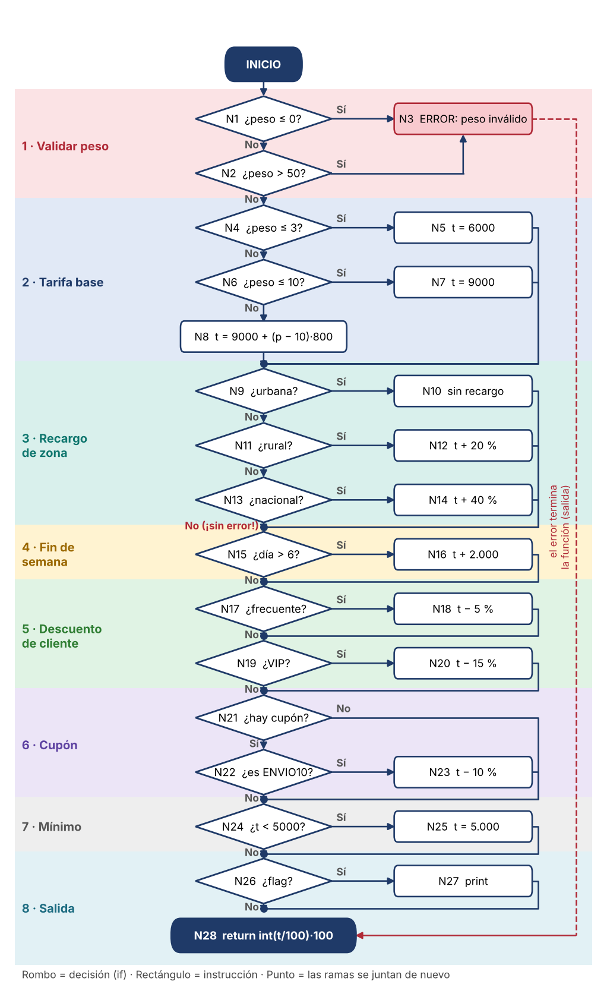

# Parte 4 · Caja blanca de `calc`

**Estudiante:** Elkin Eliecer Aguas Giraldo · **Parámetros:** L1 = 3, L2 = 10, PMAX = 50

## La idea en palabras

En caja negra probamos *qué* hace la función sin mirar el código. En caja blanca miramos *cómo* está escrita y comprobamos que cada decisión (`if`) se pruebe por los dos lados: cuando es verdadera y cuando es falsa.

`calc` es una cadena de decisiones una detrás de otra. Cada decisión es una bifurcación en el camino. Entre más bifurcaciones, más caminos distintos hay que probar. Ese número se mide con la **complejidad ciclomática**.

---

## 1. Grafo de flujo

Cada nodo es una decisión (rombo) o un bloque de instrucciones (rectángulo). La condición `p <= 0 or p > 50` se separa en dos decisiones (N1 y N2) porque Python evalúa cada parte por separado.

**Cómo leerlo (de arriba hacia abajo):**

- La columna del centro es el camino principal. Cada rombo es una pregunta (`if`) y cada rectángulo es una instrucción.
- Si la respuesta es **Sí**, la flecha sale a la derecha hacia la instrucción. Si es **No**, la flecha sigue hacia abajo.
- Los **puntos** son los lugares donde las ramas se juntan otra vez en el camino principal.
- Las franjas de color agrupan el grafo en las 8 etapas del cálculo, en el mismo orden de la especificación.
- El único camino que termina antes es el error (N3), con la línea punteada roja.
- En N13: si la zona no es urbana, rural ni nacional, el flujo sigue **sin error**. Ese es el defecto de R2 que se probara en P8.

**Conteo:** 28 nodos, 14 decisiones (N1, N2, N4, N6, N9, N11, N13, N15, N17, N19, N21, N22, N24, N26) y 41 aristas (se cuenta una arista de `raise` hacia la salida, para que el grafo tenga una sola entrada y una sola salida).

---

## 2. Complejidad ciclomática (tres formas)

| Forma | Cálculo | Resultado |
|-------|---------|-----------|
| Aristas y nodos | V(G) = E − N + 2 = 41 − 28 + 2 | **15** |
| Nodos predicado | V(G) = P + 1 = 14 + 1 | **15** |
| Regiones | Regiones cerradas (14) + región exterior (1) | **15** |

Las tres coinciden. Eso significa que hay **15 caminos independientes** y que, como mínimo, necesitamos 15 casos para recorrerlos todos.

si alguien cuenta `p <= 0 or p > 50` como una sola decisión, le da 14. Es válido, pero tomo 15 porque son dos condiciones distintas.

---

## 3. Caminos independientes y su caso de prueba

La idea: empezamos con un camino "base" (el más normal) y cada camino siguiente cambia **una sola decisión** respecto a la base. Así cada camino aporta una arista nueva.

Camino base (P3): peso 2, urbana, día 3, cliente normal, sin cupón.

| Camino | Qué cambia | Entradas (p, z, c, d, cup) | Resultado esperado (según especificación) |
|--------|-----------|----------------------------|-------------------------------------------|
| P1 | Peso ≤ 0 | (0, urbana, normal, 3, None) | Error "peso inválido" |
| P2 | Peso > 50 | (51, urbana, normal, 3, None) | Error "peso inválido" |
| P3 | **Base** | (2, urbana, normal, 3, None) | 6.000 |
| P4 | Tramo 2 | (5, urbana, normal, 3, None) | 9.000 |
| P5 | Tramo 3 | (12, urbana, normal, 3, None) | 9.000 + 2·800 = 10.600 |
| P6 | Zona rural | (2, rural, normal, 3, None) | 6.000 · 1,20 = 7.200 |
| P7 | Zona nacional | (2, nacional, normal, 3, None) | 6.000 · 1,40 = 8.400 |
| P8 | Zona inválida | (2, "marciana", normal, 3, None) | Error (R2) |
| P9 | Fin de semana | (2, urbana, normal, 7, None) | 6.000 + 2.000 = 8.000 |
| P10 | Cliente frecuente | (2, urbana, frecuente, 3, None) | 6.000 · 0,95 = 5.700 |
| P11 | Cliente VIP | (2, urbana, vip, 3, None) | 6.000 · 0,85 = 5.100 |
| P12 | Cupón desconocido | (2, urbana, normal, 3, "XYZ") | 6.000 (se ignora, F par) |
| P13 | Cupón ENVIO10 | (2, urbana, normal, 3, "ENVIO10") | 6.000 · 0,90 = 5.400 |
| P14 | Mínimo $5.000 | (2, urbana, vip, 3, "ENVIO10") | 6.000 · 0,85 · 0,90 = 4.590 → sube a 5.000 |
| P15 | `flag = True` | (2, urbana, normal, 3, None, flag=True) | 6.000 (y además imprime) |

**Dos casos extra que no son caminos nuevos pero destapan defectos** (el código heredado falla en ellos):

| Caso | Entradas | Esperado | Qué defecto revela |
|------|----------|----------|--------------------|
| X1 | (2, urbana, normal, **6**, None) | 8.000 | El sábado no recibe recargo (`d > 6` debería ser `d >= 6`) |
| X2 | (2, urbana, normal, 3, None) con día 9 | Error (R2) | El día fuera de 1 a 7 no se valida |

P8 y X2 van a fallar contra el código heredado.

---

## 4. Cobertura de sentencias y de ramas

**Cobertura de sentencias:** que cada línea se ejecute al menos una vez. Bastan **4 casos**:

| Caso | Entradas | Sentencias que cubre |
|------|----------|----------------------|
| S1 | (0, urbana, normal, 3, None) | el `raise` |
| S2 | (2, urbana, vip, 3, "ENVIO10", flag=True) | tramo 1, zona urbana, VIP, cupón, mínimo 5.000, `print` |
| S3 | (5, rural, frecuente, 7, None) | tramo 2, rural, fin de semana, frecuente |
| S4 | (12, nacional, normal, 3, None) | tramo 3, nacional |

**Cobertura de ramas:** que cada decisión se pruebe en verdadero **y** en falso. Hay que sumar casos que cubran los "falsos" que aún faltan: **6 casos**.

| Caso | Entradas | Rama que aporta |
|------|----------|-----------------|
| S1 a S4 | los de arriba | verdadero de casi todas las decisiones |
| S5 | (51, urbana, normal, 3, None) | `p > 50` verdadero |
| S6 | (2, "marciana", normal, 3, "XYZ") | zona que no es ninguna de las tres, y cupón distinto de ENVIO10 |

Comprobación decisión por decisión:

| Decisión | Verdadero | Falso |
|----------|-----------|-------|
| N1 `p ≤ 0` | S1 | S2 |
| N2 `p > 50` | S5 | S2 |
| N4 `p ≤ 3` | S2 | S3 |
| N6 `p ≤ 10` | S3 | S4 |
| N9 urbana | S2 | S3 |
| N11 rural | S3 | S4 |
| N13 nacional | S4 | S6 |
| N15 `d > 6` | S3 | S2 |
| N17 frecuente | S3 | S2 |
| N19 vip | S2 | S3 |
| N21 `cup ≠ None` | S2 | S3 |
| N22 `cup == ENVIO10` | S2 | S6 |
| N24 `t < 5000` | S2 | S3 |
| N26 `flag` | S2 | S3 |

Todas las decisiones quedan probadas por ambos lados con 6 casos.

**Resumen:** sentencias → 4 casos · ramas → 6 casos · caminos independientes → 15 casos.