# Parte 5 · Automatización, ejecución y defectos

**Estudiante:** Elkin Eliecer Aguas Giraldo · **Código:** 0182410020
**Código probado:** `envios.py` versión heredada v1.0.0.

## 5.1 Qué hice, en palabras

Convertí mis casos de prueba en pruebas automáticas con **pytest** y las ejecuté contra el código
heredado. Una prueba automática le entrega a `calc` los mismos datos de un caso y compara lo que devuelve con el
resultado que yo calculé a mano. Si no coinciden, la prueba falla y eso señala un defecto.

| Archivo | Qué contiene |
|---------|--------------|
| `tests/test_caja_negra.py` | Los 40 casos TC-01 a TC-40 de la Parte 3, más una prueba del mensaje de error |
| `tests/test_caja_blanca.py` | Los caminos P01 a P14 y los casos extra X1 y X2 de la Parte 4, más la prueba de `flag` (P15) |
| `pytest.ini` | Le dice a pytest que busque las pruebas en `tests/` |

**Cómo se ejecuta**

```
python -m pytest -v
python -m pytest --cov=envios --cov-branch --cov-report=term-missing
```

**Una aclaración importante:** los resultados esperados vienen de mis cálculos a mano y no de `calc`.
También los comprobé con un segundo cálculo exacto e independiente (con fracciones, sin decimales
flotantes): coincidieron los 56 casos con resultado numérico o de error.

## 5.2 Qué pasó al ejecutarlas contra v1.0.0

**58 pruebas: 40 pasan y 18 fallan.**

Las 18 fallas se explican con **5 defectos**. Para saber cuál prueba falla por cuál defecto, arreglé cada
defecto por separado en una copia y miré cuáles pruebas se ponían en verde.

| Defecto | Pruebas que fallan por él |
|---------|---------------------------|
| DEF-01 · el sábado no se recarga | TC-16, TC-26, X1 |
| DEF-02 · el redondeo corta | TC-08, TC-22, TC-23, TC-24, TC-25, TC-35 |
| DEF-01 y DEF-02 juntos | TC-28, TC-30, TC-34 (fallan por los dos a la vez) |
| DEF-03 · zona inválida sin error | TC-14, P08 |
| DEF-04 · día inválido sin error | TC-18, TC-19, X2 |
| DEF-05 · mensaje sin tilde | `test_mensaje_de_error_de_peso` |

Total: 3 + 6 + 3 + 2 + 3 + 1 = 18.

## 5.3 Cobertura

Con `pytest-cov` y medición de ramas: **sentencias 100 % (29 de 29)** y **ramas 100 % (26 de 26)**.

1. **Cobertura 100 % no significa "sin defectos".** Aquí todo el código se ejecuta, y aun así hay 18 pruebas
   fallando. La cobertura dice qué líneas se *recorrieron*, no si el resultado fue *correcto*. Por eso los
   resultados esperados calculados a mano son lo que realmente encuentra los defectos.
2. **¿Por qué 26 ramas y no 28?** `coverage.py` cuenta una decisión por línea: trata `p <= 0 or p > 50` como una sola
   decisión. Eso da 13 decisiones × 2 ramas = 26. En la Parte 4 separé esa línea en dos decisiones (14 en total) para
   la complejidad ciclomática. Son dos formas válidas de contar, y la diferencia está en eso.

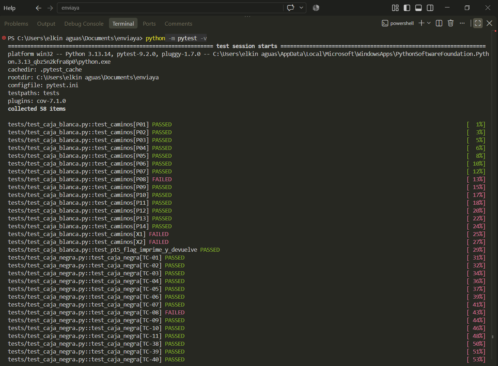
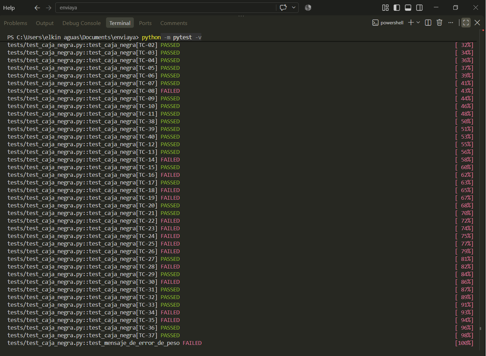
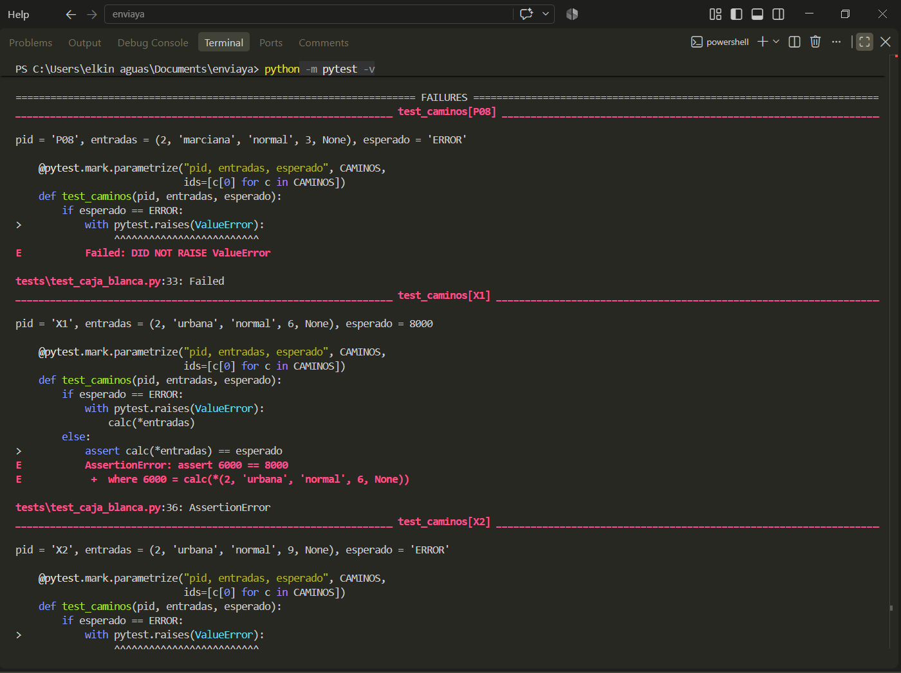
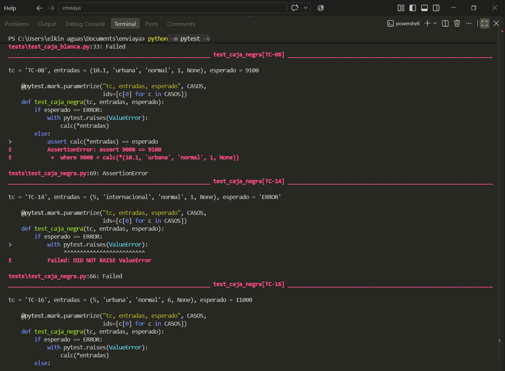
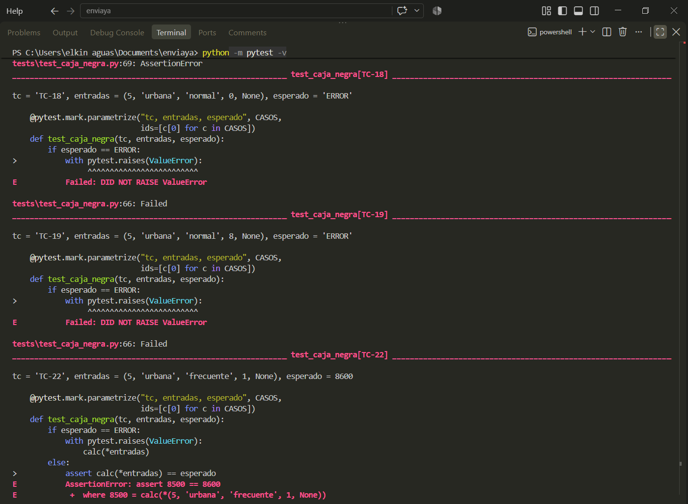
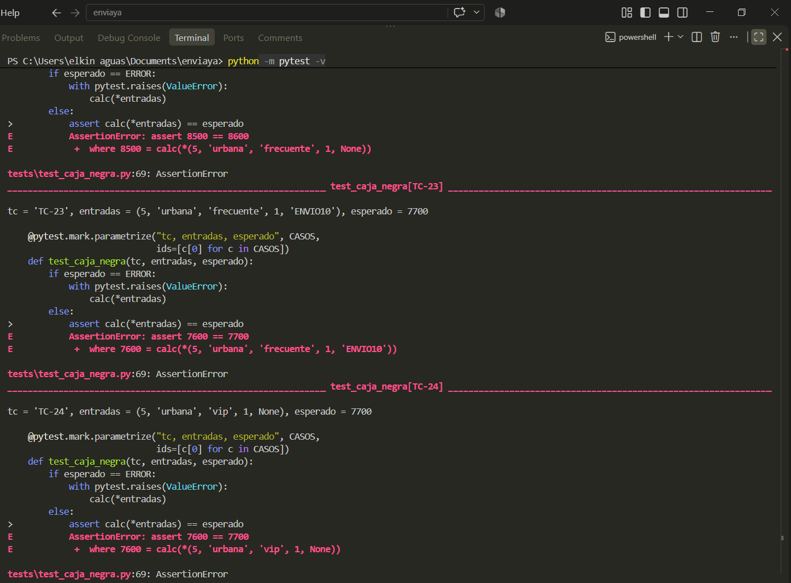
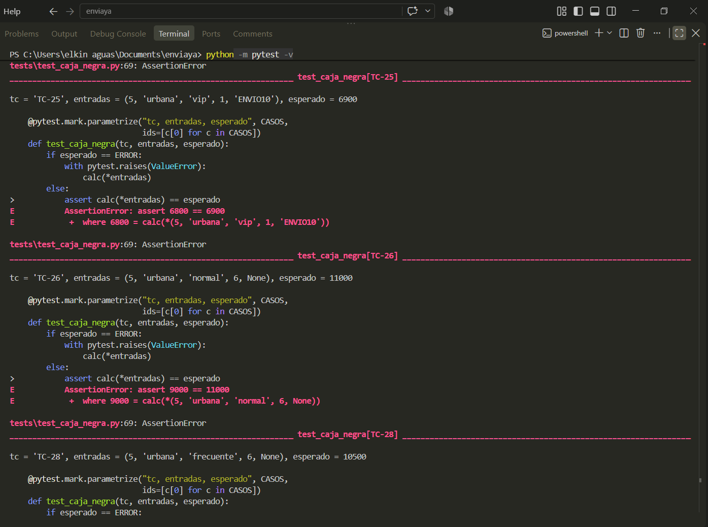
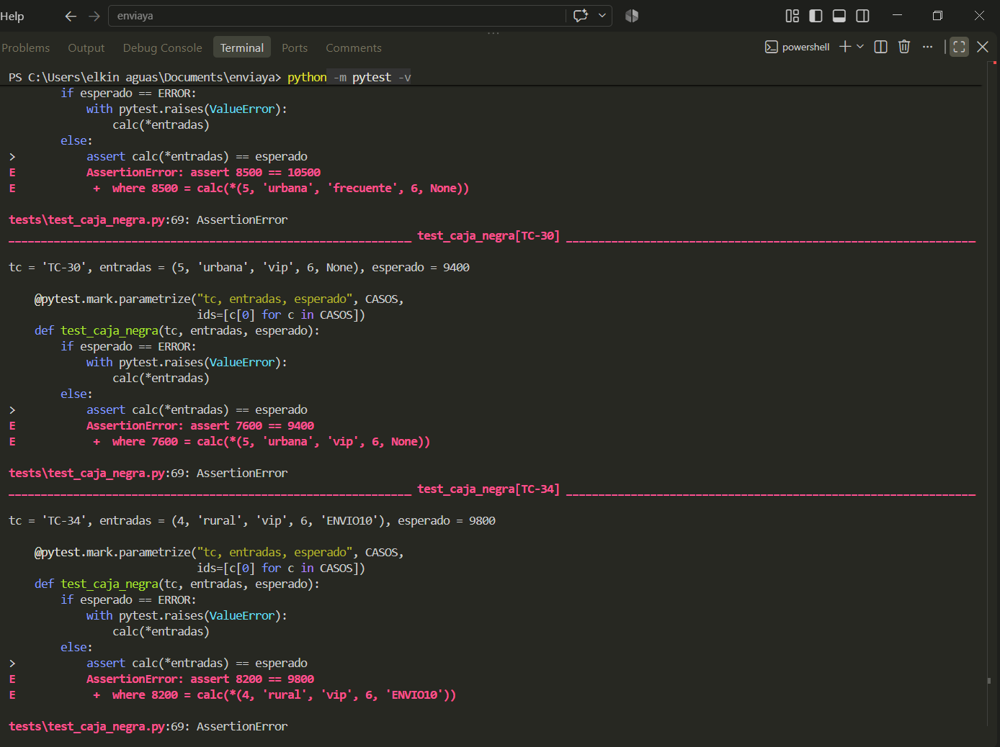
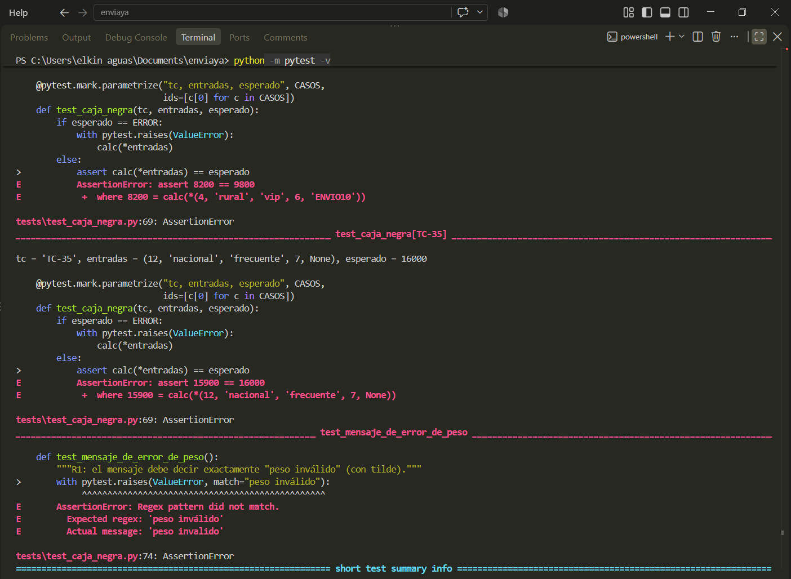
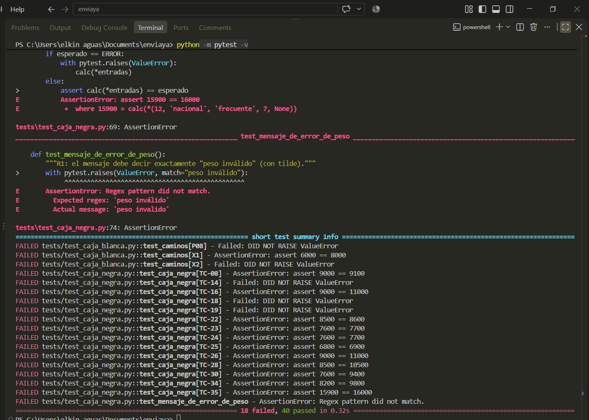
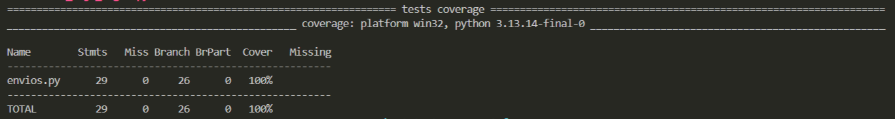

## 5.4 Registro de defectos

**Cómo justifiqué la gravedad y la prioridad**

- **Severidad** = cuánto daño hace el defecto cuando ocurre. *Alta*: cobra mal dinero en envíos válidos. *Media*:
  acepta datos que debería rechazar. *Baja*: es un detalle de forma que no cambia ningún cobro.
- **Prioridad** = qué tan pronto hay que corregirlo. Depende de cuánta gente afecta y de qué tan fácil es que ocurra.

---

### DEF-01 · El sábado no recibe el recargo de fin de semana

| Campo | Detalle |
|-------|---------|
| Requisito que incumple | R5 (fin de semana: sábado y domingo) |
| Dónde está | `if d > 6:` solo recarga el domingo (día 7). Debería ser `d >= 6` |
| Pasos para reproducirlo | Ejecutar `calc(5, "urbana", "normal", 6, None)` |
| Resultado esperado | $11.000 (9.000 + 2.000) |
| Resultado obtenido | $9.000 |
| Pruebas que lo detectan | TC-16, TC-26, TC-28, TC-30, TC-34, X1 |
| **Severidad** | **Alta.** Cada envío de un sábado se cobra $2.000 de menos (más lo que ese recargo se llevaría en descuentos). La empresa pierde plata en cada uno. |
| **Prioridad** | **Alta.** Los sábados son un día normal de operación y el error ocurre en todos los envíos de ese día. |

### DEF-02 · El redondeo corta en vez de acercar a la centena más cercana

| Campo | Detalle |
|-------|---------|
| Requisito que incumple | R8 (redondear a la centena más cercana; los $50 suben) |
| Dónde está | `return int(t / 100) * 100` descarta los decimales, es decir, siempre baja |
| Pasos para reproducirlo | Ejecutar `calc(5, "urbana", "frecuente", 1, None)` |
| Resultado esperado | $8.600 (da 8.550 y el 50 sube) |
| Resultado obtenido | $8.500 |
| Otros ejemplos | `calc(10.1, ...)` da 9.000 y debe dar 9.100. `calc(5, "urbana", "vip", 1, "ENVIO10")` da 6.800 y debe dar 6.900 |
| Pruebas que lo detectan | TC-08, TC-22, TC-23, TC-24, TC-25, TC-28, TC-30, TC-34, TC-35 |
| **Severidad** | **Alta.** Cobra de menos en cualquier cálculo cuyo resto sea de 50 o más. Se repite en casi todos los envíos con descuento. |
| **Prioridad** | **Alta.** Afecta a una gran parte de los envíos y es fácil de corregir. |

### DEF-03 · Una zona que no existe no lanza error

| Campo | Detalle |
|-------|---------|
| Requisito que incumple | R2 (la zona debe ser urbana, rural o nacional) |
| Dónde está | La cadena `if / elif` de zonas no tiene un `else` final |
| Pasos para reproducirlo | Ejecutar `calc(5, "internacional", "normal", 1, None)` |
| Resultado esperado | Un error |
| Resultado obtenido | $9.000: se cotiza como si fuera urbana |
| Pruebas que lo detectan | TC-14, P08 |
| **Severidad** | **Media.** No altera el cálculo de zonas válidas, pero un envío a una zona inexistente se cotiza sin aviso y con el precio de la zona más barata. |
| **Prioridad** | **Media.** Solo ocurre cuando llega un dato inválido, pero se corrige con tres líneas. |

### DEF-04 · Un día fuera del rango de 1 a 7 no lanza error

| Campo | Detalle |
|-------|---------|
| Requisito que incumple | R2 (el día debe ir de 1 a 7) |
| Dónde está | El código nunca revisa el valor de `d` |
| Pasos para reproducirlo | Ejecutar `calc(5, "urbana", "normal", 0, None)` y `calc(5, "urbana", "normal", 8, None)` |
| Resultado esperado | Un error en los dos casos |
| Resultado obtenido | $9.000 con el día 0, y $11.000 con el día 8 (lo toma como fin de semana) |
| Pruebas que lo detectan | TC-18, TC-19, X2 |
| **Severidad** | **Media.** Un día inválido puede cobrar un recargo de fin de semana que no corresponde (día 8). |
| **Prioridad** | **Media.** Es un dato inválido, no un caso habitual. Se arregla junto con DEF-03 porque los dos son de R2. |

### DEF-05 · El mensaje de error del peso no dice "peso inválido"

| Campo | Detalle |
|-------|---------|
| Requisito que incumple | R1 (el mensaje debe ser "peso inválido") |
| Dónde está | `raise ValueError("peso invalido")` no lleva tilde |
| Pasos para reproducirlo | Ejecutar `calc(0, "urbana", "normal", 1)` y leer el mensaje |
| Resultado esperado | `peso inválido` |
| Resultado obtenido | `peso invalido` |
| Prueba que lo detecta | `test_mensaje_de_error_de_peso` |
| **Severidad** | **Baja.** El error se lanza bien. Solo cambia una letra del texto y no afecta ningún cobro. |
| **Prioridad** | **Baja.** Se corrige cuando se toque esa línea. |

---

## 5.5 Líneas que parecen defectos pero con mis dígitos están bien

No las reporto como defectos. Si las reportara perdería puntos.

| Línea | Por qué está bien |
|-------|-------------------|
| `if p <= CONFIG["L1"]` | D = 0 es par: el 3 incluye el límite, y `<=` hace justo eso |
| El recargo de fin de semana se suma antes de los descuentos | E = 2 es par: ese es el orden correcto |
| Se aplican el descuento del cliente y después el del cupón | B = 1 es impar: se aplican los dos, cliente primero |
| `if cup == "ENVIO10"` sin `else` | F = 0 es par: un cupón que no existe se ignora |
| `if p <= 0 or p > 50` | 50 es mi PMAX. No es defecto; es un número mágico, que trato en la Parte 6 |

## 5.6 Métricas

| Métrica | Cálculo | Resultado |
|---------|---------|-----------|
| Pruebas ejecutadas | 40 de caja negra, 16 de caminos y casos extra, 1 de `flag`, 1 de mensaje | **58** |
| Pruebas que pasan | 58 − 18 = 40 | **40** |
| Porcentaje que pasa | 40 / 58 × 100 | **68,97 %** |
| Porcentaje que falla | 18 / 58 × 100 | **31,03 %** |
| Defectos totales | DEF-01 a DEF-05 | **5** |
| Defectos por severidad | Alta: DEF-01 y DEF-02 · Media: DEF-03 y DEF-04 · Baja: DEF-05 | **2 · 2 · 1** |
| Líneas de código de `envios.py` | Según `git`, el commit v1.0.0 tiene 39 líneas | **39** |
| Densidad de defectos | 5 / 39 × 100 | **12,82 por cada 100 líneas** |
| Cobertura de sentencias | 29 de 29 | **100 %** |
| Cobertura de ramas | 26 de 26 | **100 %** |

## 5.7 Cómo se actualiza la trazabilidad

La matriz de la Parte 1 queda completada con este reporte:

| Requisito | Defecto | Pruebas que lo detectan |
|-----------|---------|-------------------------|
| R1 | DEF-05 | `test_mensaje_de_error_de_peso` |
| R2 | DEF-03, DEF-04 | TC-14, P08, TC-18, TC-19, X2 |
| R5 | DEF-01 | TC-16, TC-26, TC-28, TC-30, TC-34, X1 |
| R8 | DEF-02 | TC-08, TC-22 a TC-25, TC-28, TC-30, TC-34, TC-35 |
| R3, R4, R6, R7 | ninguno | pasan todas |
