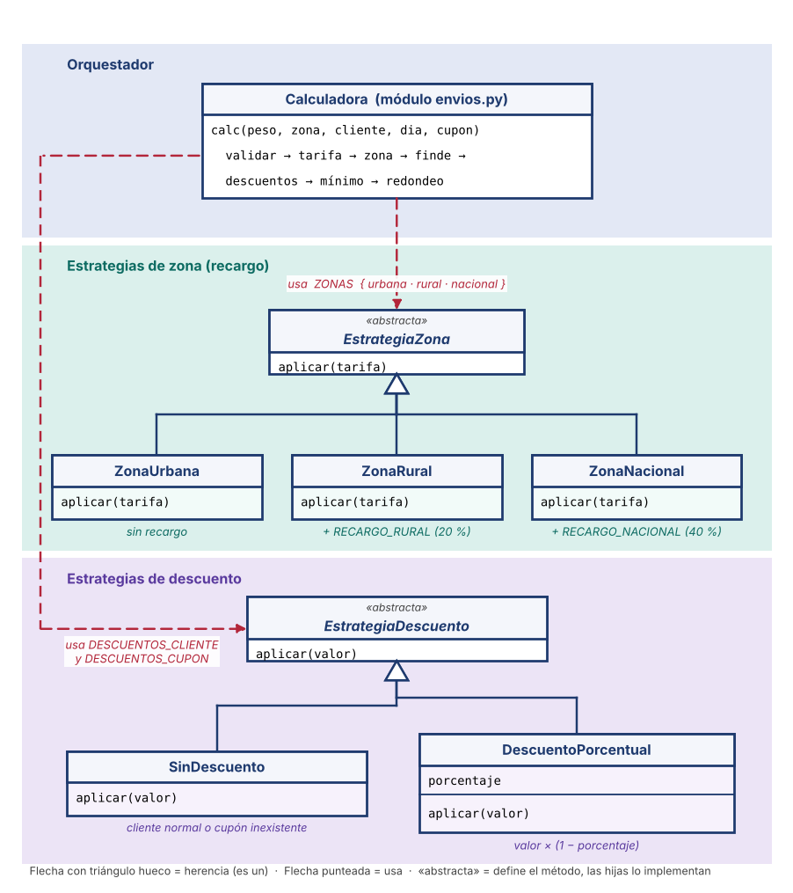
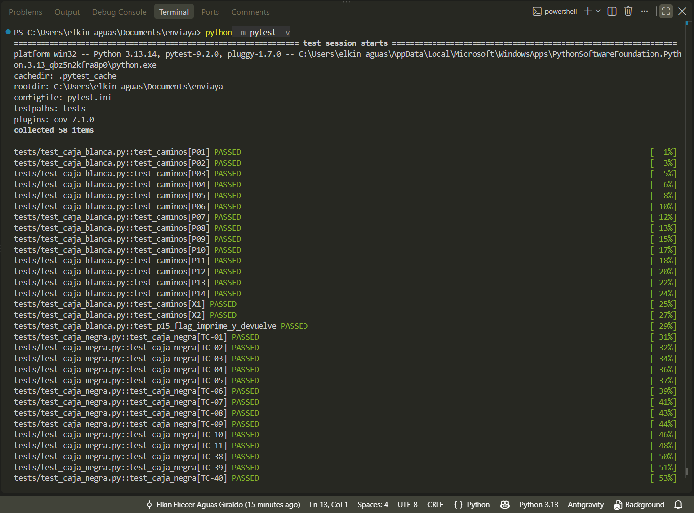
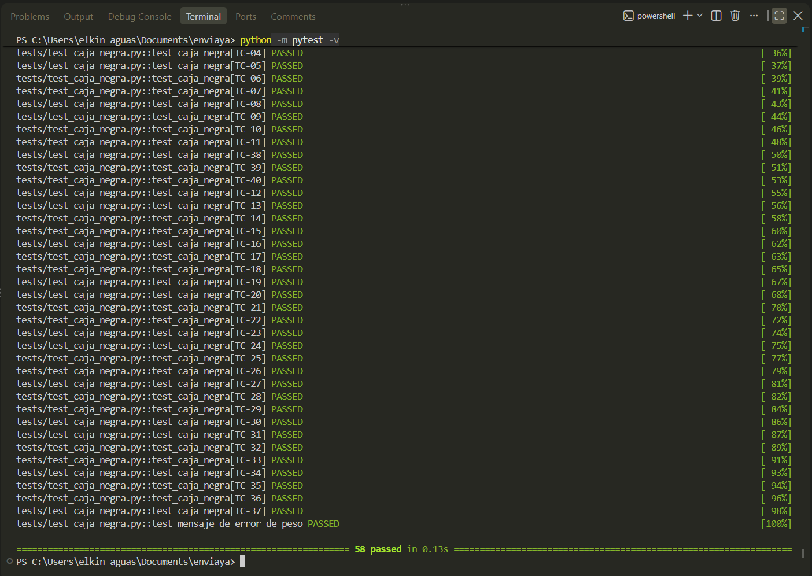
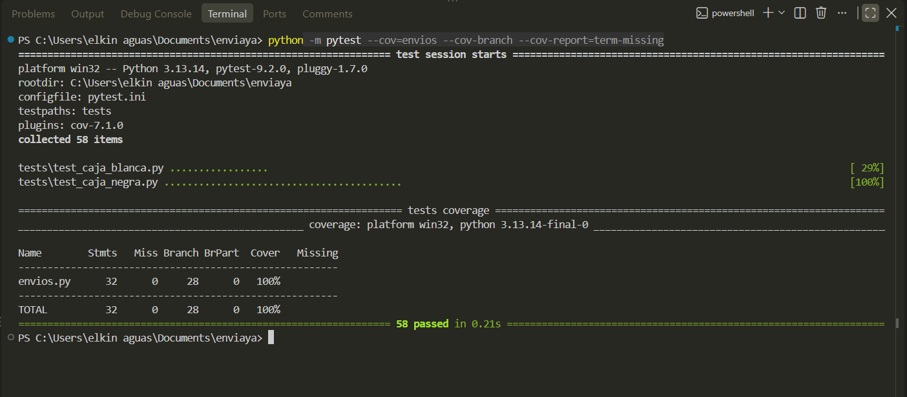
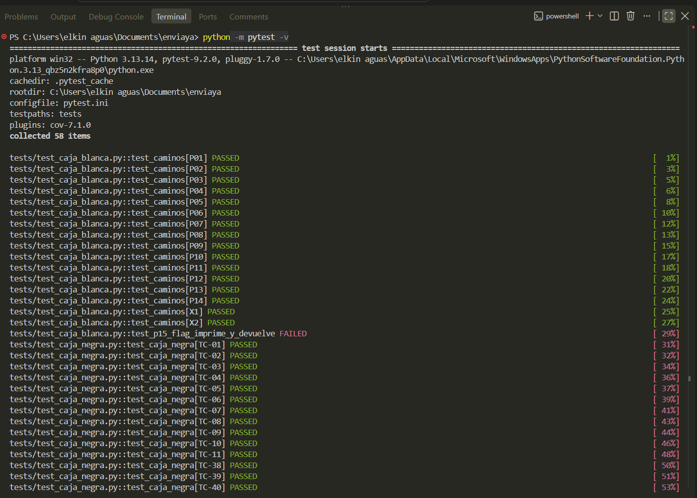
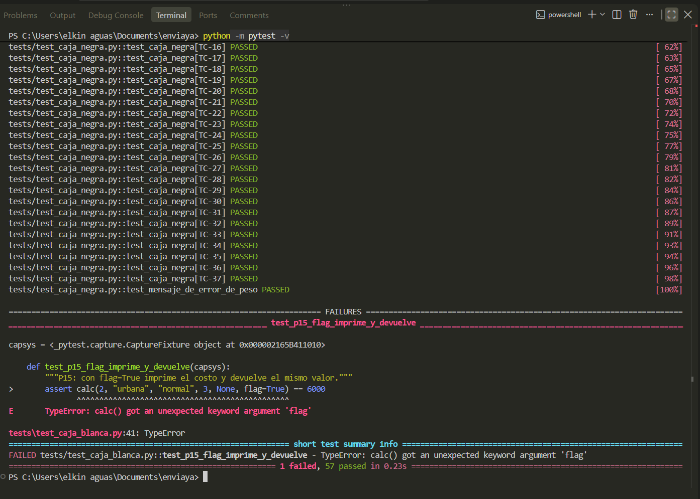
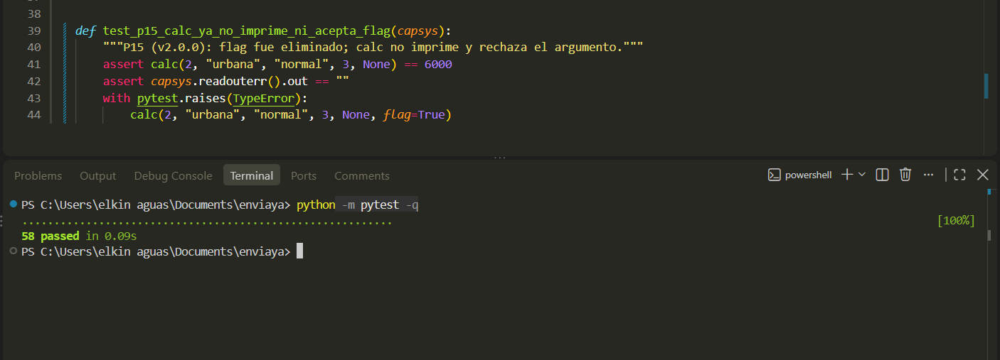
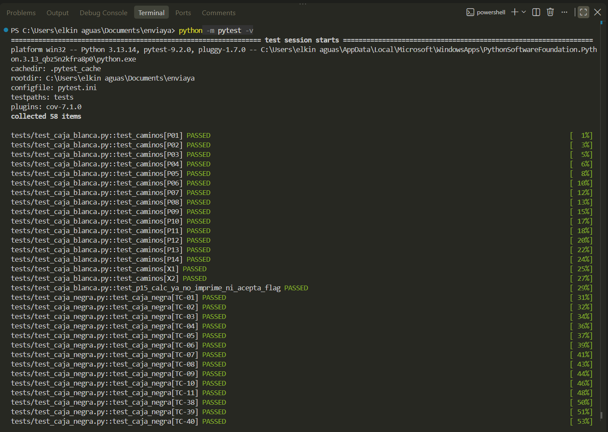
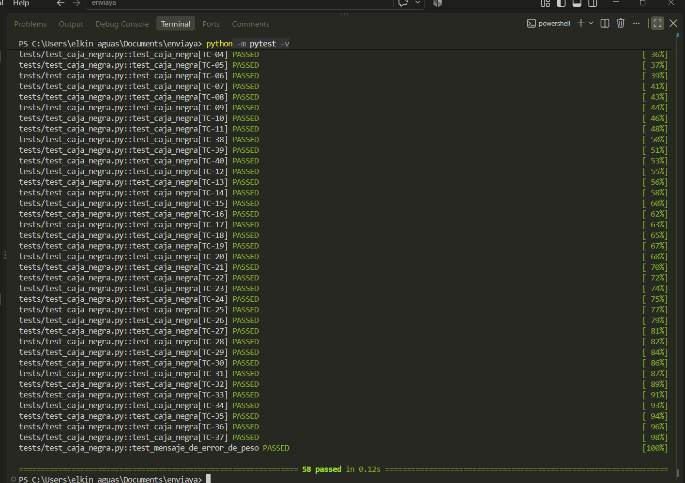
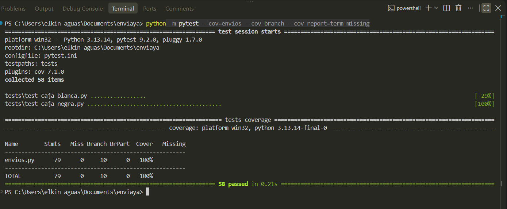

# Parte 6 · Mantenimiento y refactorización

Estudiante: Elkin Eliecer Aguas Giraldo · Código 0182410020 · Parámetros: PMAX 50, L1 3, L2 10, RR 20 %, RN 40 %, V 15 %, S $2.000.

Los números de línea corresponden a `envios.py` en `v1.0.0` (`git show v1.0.0:envios.py`).

## 6.1 Malos olores (code smells)

| # | Mal olor | Línea(s) | Deuda técnica que genera |
|---|---|---|---|
| 1 | **Números mágicos** | 11, 14, 16, 18, 26, 29, 33–34, 35–36, 39 | Nadie sabe qué significa cada número ni dónde más se usa. Cambiar una tarifa obliga a buscar el número a mano y puede dejar valores inconsistentes. El `50` además duplica PMAX, que debería vivir en la configuración. |
| 2 | **Método extenso** | 10–39 | Es difícil de leer y de probar por partes. Cualquier cambio toca la misma función y el riesgo de romper otra regla crece con cada modificación. |
| 3 | **Nombres misteriosos** | 10 y todo el cuerpo | El código no se explica solo. Quien lo mantiene tiene que deducir el significado, y eso causa errores de interpretación. |
| 4 | **Flag Argument y efecto secundario** | 10, 37–38 | La función hace dos cosas distintas según un booleano y mezcla lógica con salida por consola. Es difícil de probar y de reutilizar, y el `print` es ruido en producción. |
| 5 | **Condicionales repetidos** | 19–24, 28–34 | Agregar una zona o un tipo de cliente obliga a editar la cadena de `if`. Eso viola el principio abierto/cerrado, y la Parte 8 pide justo ese tipo de cambio. |
| 6 | **Código duplicado** | 22, 24, 29, 31, 34 | La misma operación escrita cinco veces. Si cambia la forma de calcular un porcentaje, hay que corregir cinco sitios. |
| 7 | **Código muerto / sentencia sin efecto** | 20 | Ruido que confunde al lector y sugiere que falta lógica. |
| 8 | **Condicional anidado y comparación no idiomática** | 32–34 | Anidación innecesaria. En Python se compara con `is None` y el `if` doble se simplifica. |
| 9 | **Variable reutilizada** | 14–36 | Una variable con cinco significados dificulta seguir el valor y depurar. |
| 10 | **Obsesión por primitivos y fallo silencioso** (zona, cliente y cupón son cadenas sueltas) | 19–34 | Una zona inválida se trata como urbana sin avisar (DEF-03). Los valores válidos no están en un solo lugar. |

## 6.2 Clasificación de cada cambio

| Cambio | Tipo de mantenimiento | Justificación |
|---|---|---|
| DEF-01 a DEF-05 | **Correctivo** | Corrigen defectos que incumplen R1, R2, R5 y R8. |
| Extraer funciones (`validar_entradas`, `tarifa_base`, etc.) | **Perfectivo** | Mejora la estructura sin cambiar el comportamiento. |
| Constantes con nombre y nombres descriptivos | **Perfectivo** | Mejora la legibilidad y la mantenibilidad. |
| Eliminar `flag` | **Perfectivo** | Quita una función con dos responsabilidades. Cambia la interfaz pública. |
| Patrón Estrategia para zonas y descuentos | **Preventivo** | Prepara el código para nuevas zonas y descuentos, como la solicitud de la Parte 8. |
| Aritmética exacta con `Fraction` | **Preventivo** | Evita que los errores de punto flotante afecten el redondeo de los $50. |

No hay cambios adaptativos: el entorno (lenguaje, plataforma, normas externas) no cambió.

## 6.3 Refactorización realizada

- **Extracción de funciones:** `validar_entradas`, `tarifa_base`, `recargo_fin_de_semana`, `aplicar_descuentos`, `aplicar_costo_minimo`, `redondear_a_centena`. `calc` solo orquesta los pasos en el orden de la especificación.
- **Constantes con nombre:** todas las tarifas, límites, porcentajes y el costo mínimo, en un bloque al inicio.
- **Argumento `flag` eliminado:** la función ya no imprime. Quien quiera ver el costo lo imprime con el valor que retorna.
- **Estrategia:** `EstrategiaZona` con `ZonaUrbana`, `ZonaRural` y `ZonaNacional`; `EstrategiaDescuento` con `SinDescuento` y `DescuentoPorcentual`. Los diccionarios `ZONAS`, `DESCUENTOS_CLIENTE` y `DESCUENTOS_CUPON` eligen la estrategia sin cadenas de `if`.
- **Reglas que dependen de la paridad se conservan:** el recargo de fin de semana va antes de los descuentos (E par), cliente y cupón se aplican ambos, primero el del cliente (B impar), y un cupón inexistente se ignora (F par).

### Diagrama de clases UML

Cómo leerlo, de arriba hacia abajo:

- **Calculadora (`calc`)** es quien orquesta. No sabe cuánto vale cada recargo ni cada descuento: solo busca la estrategia que corresponde y la usa.
- **`EstrategiaZona`** es la interfaz abstracta y tiene tres hijas. Cada una implementa `aplicar(tarifa)` a su manera: urbana no cambia nada, rural suma 20 % y nacional suma 40 %. `calc` elige la hija con el diccionario `ZONAS`.
- **`EstrategiaDescuento`** es la interfaz de los descuentos. `SinDescuento` devuelve el valor igual (cliente normal o cupón inexistente) y `DescuentoPorcentual` aplica `valor × (1 − porcentaje)`. Con distintos porcentajes sirve para frecuente (5 %), VIP (15 %) y ENVIO10 (10 %).
- **Para agregar algo nuevo** (una zona, o el cliente empresarial de la Parte 8) se crea una clase o una entrada en el diccionario, sin tocar `calc`.

## 6.4 Corrección de defectos

Los cinco defectos del reporte (DEF-01 a DEF-05) se corrigieron en las ramas `fix/DEF-01` a `fix/DEF-05` y se publicaron como `v1.0.1`. La refactorización mantiene esas correcciones.

Resultado después de corregir los cinco defectos (`v1.0.1`): las mismas 58 pruebas pasan y la cobertura sigue en 100 %.

## 6.5 Pruebas de regresión

Se ejecutaron las mismas 58 pruebas de la Parte 5. Resultado esperado: 58 passed. Capturas: 

De las 58 pruebas, 57 no cambiaron. P15 se actualizó porque la refactorización eliminó el argumento `flag`: ahora comprueba que `calc` no imprime y que rechaza `flag` con `TypeError`.

## 6.6 Comparación antes y después

| Métrica | v1.0.0 (heredado) | v1.0.1 (corregido) | v2.0.0 (refactorizado) |
|---|---|---|---|
| Complejidad ciclomática de `calc` | 15 | 17 | **1** |
| Complejidad máxima de una función | 15 | 17 | 6 (`validar_entradas`) |
| Líneas de código (sin vacías ni comentarios) | 37 | 41 | 98 |
| Cobertura de sentencias y de ramas | 100 % / 100 % (29 y 26) | 100 % / 100 % (32 y 28) | 100 % / 100 % (79 y 10) |

Lectura de los números: las líneas de código **suben**, porque las clases, los nombres y las constantes ocupan espacio. Lo que baja es la complejidad por función. Ya ninguna función supera 6 caminos independientes, y cada regla vive en un solo lugar. La complejidad total del sistema no desaparece, solo se reparte en piezas pequeñas que se prueban por separado.
