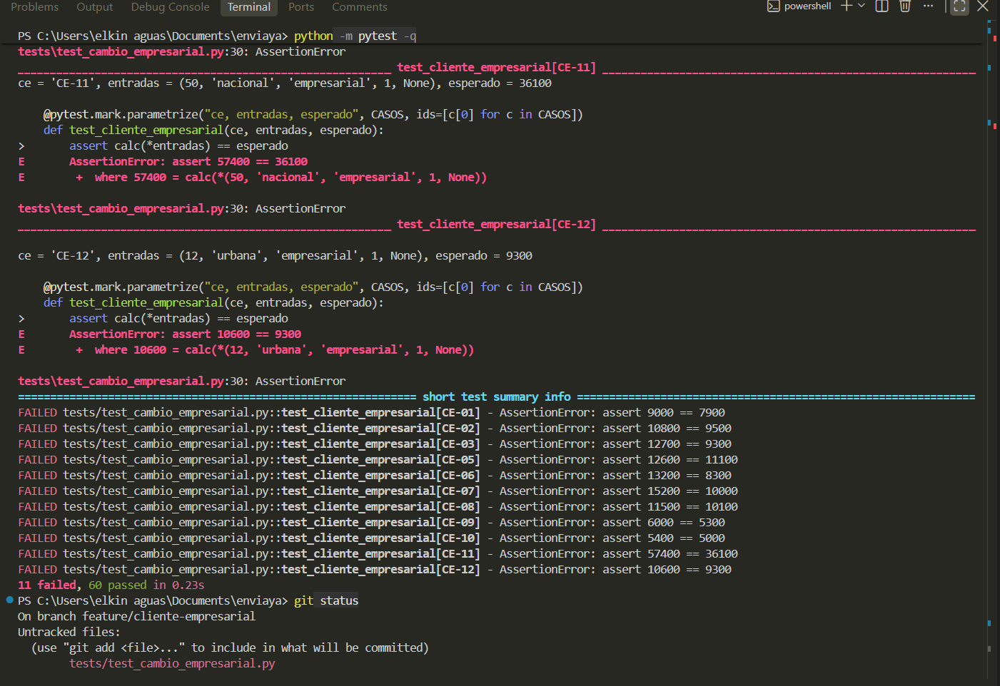
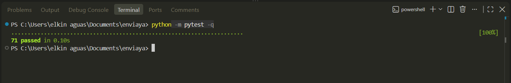

# Parte 8 · Solicitud de cambio y análisis de impacto

Estudiante: Elkin Eliecer Aguas Giraldo · Código 0182410020 · (A + F) mod 3 = (4 + 0) mod 3 = **1**

**Solicitud de cambio 1:** nuevo tipo de cliente **empresarial** con 12 % de descuento. Si el peso es mayor que L2 (10 kg), el recargo de zona no se cobra.

**Supuesto de interpretación:** la segunda frase se aplica al cliente empresarial, porque aparece como parte de su condición comercial. Un cliente normal, frecuente o VIP sigue pagando el recargo de zona aunque pese más de 10 kg (caso de control CE-04).

## 8.1 Análisis de impacto

| Elemento | ¿Se afecta? | Qué cambia |
|---|---|---|
| **R4** Recargo por zona | Sí, se modifica | Nueva excepción: no se cobra al empresarial con peso > L2. |
| **R6** Descuento de cliente | Sí, se amplía | Nuevo tipo de cliente con 12 %. Con B impar se combina con el cupón: primero el cliente y luego el cupón. |
| R3 Tarifa base | No cambia | La condición reutiliza el mismo límite L2, pero el cálculo de la tarifa es igual. |
| R5 Fin de semana | No cambia | Con E par el recargo se suma antes de los descuentos; con el empresarial queda dentro del valor que se descuenta (CE-07, CE-08). |
| R8 Mínimo y redondeo | No cambia | Se aplican igual al final (CE-10 verifica el mínimo). |
| R1, R2, R7 | No cambian | La zona sigue validándose aunque no se cobre el recargo (CE-13). |
| **Historias de usuario** | HU-02 y HU-03 | Agregar un criterio Dado/Cuando/Entonces en cada una: CASO-2.6 (recargo de zona) y CASO-3.6 (descuento con cupón). CASO-2.6 se prueba con CE-03 y CE-05, y CASO-3.6 con CE-08. |
| **Tabla de decisión** (cliente × cupón × fin de semana) | Sí | Agregar la fila del cliente empresarial. |
| **Casos de prueba existentes** | No cambian de resultado | Ninguno usa `empresarial`. Se vuelven a ejecutar los 58 como regresión. |
| **Casos nuevos** | CE-01 a CE-13 | 13 pruebas en `tests/test_cambio_empresarial.py`. |
| **Código** (`envios.py`) | Cuatro puntos | Constantes `DESCUENTO_EMPRESARIAL` y `CLIENTE_EMPRESARIAL`; una entrada en `DESCUENTOS_CLIENTE`; función nueva `aplicar_recargo_zona`; una línea en `calc` (y la versión en el docstring). |
| Clases del patrón Estrategia | No se tocan | `DescuentoPorcentual` se reutiliza con 12 %. `ZonaRural` y `ZonaNacional` no cambian. |

**Riesgo identificado:** un cliente escrito con otra forma, por ejemplo `"Empresarial"` con mayúscula, no se reconoce y se trata como cliente sin descuento. Es el mismo comportamiento heredado para clientes desconocidos y queda fuera del alcance de este cambio.

## 8.2 Tipo de mantenimiento

**Perfectivo (evolutivo).** Agrega una funcionalidad nueva que pide el negocio. No es correctivo, porque no hay un defecto. No es adaptativo, porque el entorno (lenguaje, plataforma, normas externas) no cambia. No es preventivo, porque no es una mejora interna sin efecto en el comportamiento.

## 8.3 Pruebas escritas primero

Archivo `tests/test_cambio_empresarial.py`, con resultados esperados calculados a mano (L1 = 3, L2 = 10, RR = 20 %, RN = 40 %, S = $2.000):

| ID | Entradas (peso, zona, cliente, día, cupón) | Cálculo a mano | Esperado |
|---|---|---|---|
| CE-01 | 5, urbana, empresarial, 1, — | 9.000 × 0,88 = 7.920 | $7.900 |
| CE-02 | 5, rural, empresarial, 1, — | 9.000 × 1,2 = 10.800; × 0,88 = 9.504 | $9.500 |
| CE-03 | 12, rural, empresarial, 1, — | 9.000 + 2 × 800 = 10.600; sin recargo; × 0,88 = 9.328 | $9.300 |
| CE-04 | 12, rural, **normal**, 1, — (control) | 10.600 × 1,2 = 12.720 | $12.700 |
| CE-05 | 10, nacional, empresarial, 1, — (límite: 10 no es > 10) | 9.000 × 1,4 = 12.600; × 0,88 = 11.088 | $11.100 |
| CE-06 | 10,5, nacional, empresarial, 1, — | 9.000 + 0,5 × 800 = 9.400; sin recargo; × 0,88 = 8.272 | $8.300 |
| CE-07 | 12, nacional, empresarial, 6, ENVIO10 | 10.600 + 2.000 = 12.600; × 0,88 = 11.088; × 0,90 = 9.979,2 | $10.000 |
| CE-08 | 4, rural, empresarial, 6, ENVIO10 | 10.800 + 2.000 = 12.800; × 0,88 = 11.264; × 0,90 = 10.137,6 | $10.100 |
| CE-09 | 2, urbana, empresarial, 1, — | 6.000 × 0,88 = 5.280 | $5.300 |
| CE-10 | 3, urbana, empresarial, 1, ENVIO10 | 6.000 × 0,88 × 0,90 = 4.752 → mínimo | $5.000 |
| CE-11 | 50, nacional, empresarial, 1, — | 9.000 + 40 × 800 = 41.000; sin recargo; × 0,88 = 36.080 | $36.100 |
| CE-12 | 12, urbana, empresarial, 1, — | 10.600 × 0,88 = 9.328 | $9.300 |
| CE-13 | 12, **insular**, empresarial, 1, — | la zona inválida sigue lanzando error | ValueError |

Resultado contra v2.0.0, antes de implementar: **11 fallan y 2 pasan** (CE-04 y CE-13, que deben pasar porque no dependen del cambio).

La captura muestra 11 failed y 60 passed: los 60 son las 58 pruebas anteriores más CE-04 y CE-13.

## 8.4 Implementación y resultado

Rama `feature/cliente-empresarial`. Después del cambio: **71 pruebas pasan** (58 anteriores y 13 nuevas) y la cobertura sigue en 100 % de sentencias y de ramas.

## 8.5 Versión

**v2.1.0 (MINOR):** agrega funcionalidad nueva y las llamadas existentes dan los mismos resultados (compatible hacia atrás). No es PATCH porque no corrige defectos, y no es MAJOR porque la interfaz de `calc` no cambia.

## 8.6 Matriz de trazabilidad actualizada

Así queda la matriz de la Parte 1 con el cambio. Los casos `CE-xx` están en `tests/test_cambio_empresarial.py`.

| Requisito | Historia | Criterio nuevo | Casos nuevos |
|---|---|---|---|
| R2 · zona y día válidos | HU-01 | — | CE-13 |
| R4 · recargo por zona (con excepción) | HU-02 | CASO-2.6 | CE-02, CE-03, CE-04, CE-05, CE-06, CE-07, CE-11, CE-12 |
| R5 · fin de semana, antes de descuentos | HU-02 | — | CE-07, CE-08 |
| R6 · descuento de cliente y de cupón | HU-03 | CASO-3.6 | CE-01, CE-02, CE-07, CE-08, CE-09, CE-10 |
| R8 · mínimo y redondeo | HU-03 | — | CE-01, CE-09, CE-10 |
